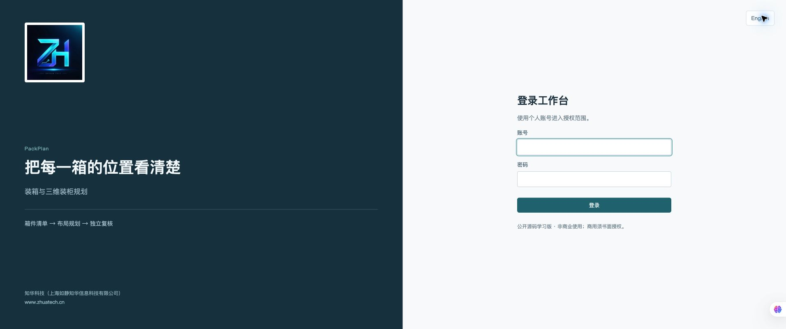
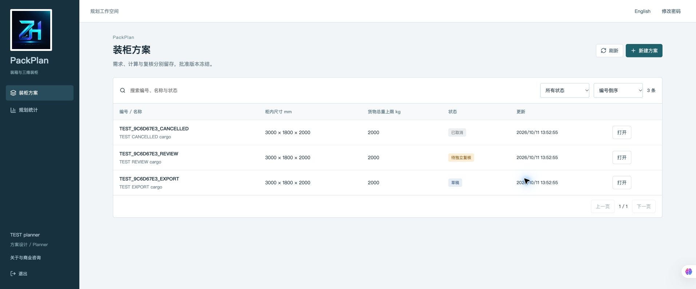
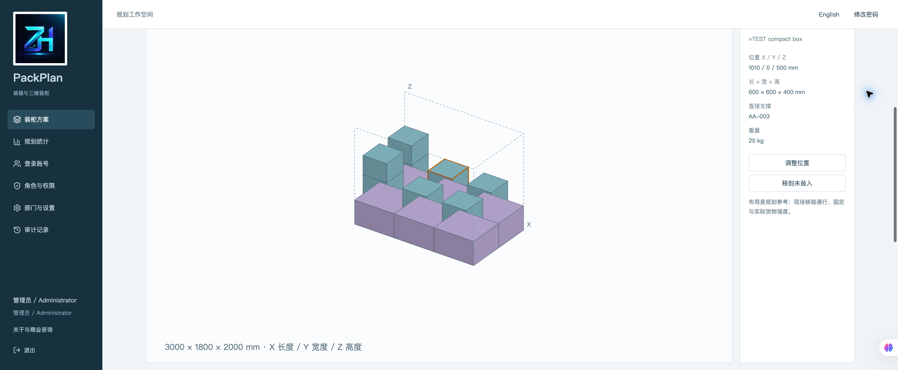
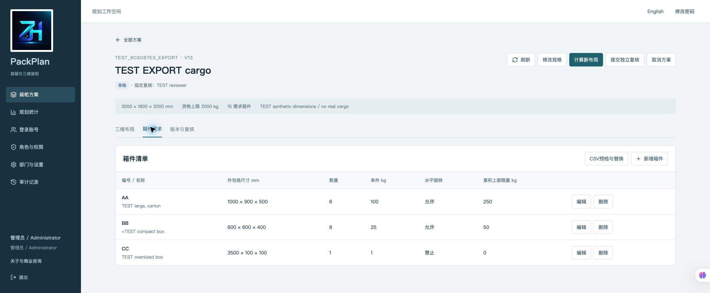
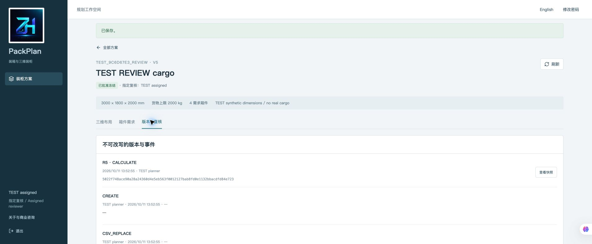
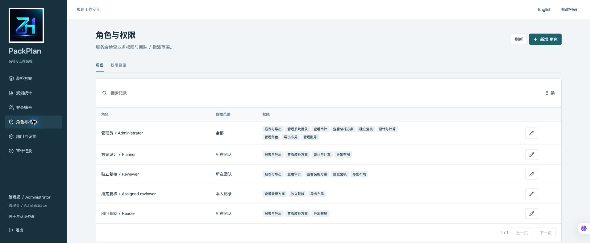
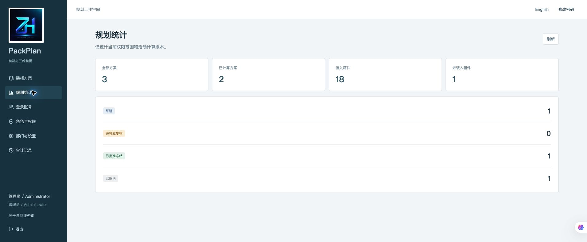
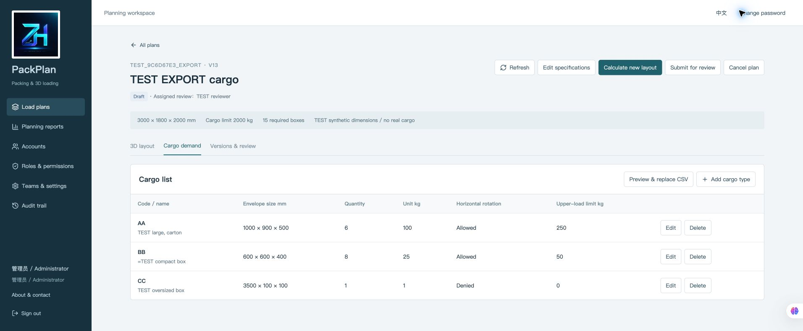
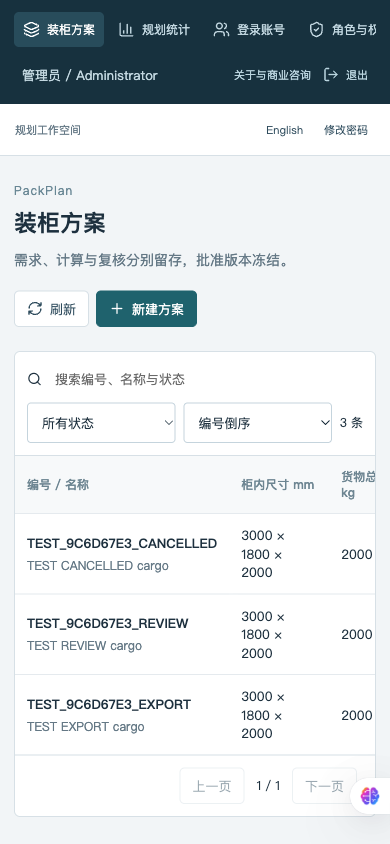

[中文](README.md) | [English](README.en.md)


# PackPlan · Packing and 3D Container Load Planning

**1.0.0 · Source-available, non-commercial learning edition · Java 21 / Spring Boot / Vue 3 / MySQL 8.4**

Provided by **ZhiHua Technology (Shanghai Rujing Zhihua Information Technology Co., Ltd.)**. [Official website](https://www.zhuatech.cn/).

A cargo planning workspace for exporters, manufacturers and freight coordinators. Retain measured internal dimensions, cargo envelopes, weight, rotation permissions, calculation revisions and independent review in a traceable record. Inspect how many boxes the current plan places, their coordinates, and the boxes still unplaced. Intended for a single organization, low-volume planning research and software learning; no verified customer savings or production capacity claims.

## From a cargo list to a reviewed layout

```text
Measured space → Cargo entries / CSV preview → Explicit replacement → Calculate
                                                                          ↓
                                      3D projection / Positions / Unplaced list
                                                                          ↓
                                           Manual revision → Full server checks
                                                                          ↓
                        Acknowledge excluded boxes → Assigned review → Freeze
                                                                          ↓
                                                 SVG / CSV / JSON snapshot
```

This is a **software planning record**. Approval does not prove physical loading occurred and sends no door, forklift or automated loading command. Physical access, door dimensions, cargo strength, restraint and transport safety require separate on-site verification.

### Implemented capabilities

| Area | Current behavior |
|---|---|
| Cargo space | Stable code, title, team, packaging category, measured internal size, cargo weight limit, note and assigned independent reviewer |
| Demand | Stable type code, name, complete envelope dimensions, quantity, unit gross weight, horizontal rotation permission and cumulative upper-load limit; draft CRUD |
| CSV import | Fixed header, UTF-8, 64KB limit, all-row preview and explicit atomic replacement; invalid rows, duplicate codes and limits reject the entire batch |
| Calculation | Original deterministic bounded heuristic comparing four demand orders; unit positions, support relations, explicit unplaced list, quantity conservation and utilization |
| Manual revisions | Select a box and edit X/Y/Z or permitted horizontal rotation; try placing an unplaced unit or explicitly remove it; save only if the complete layout passes |
| 3D inspection | Original axonometric projection, angle/zoom controls, selection, selected-only view and complete positions; pixels do not determine collisions |
| Retained versions | Every calculation/edit saves immutable input, metadata, layout and SHA256; input changes invalidate the active result while retaining history |
| Independent review | Only the assigned non-editor can approve/return; partial layouts require an exclusion acknowledgement/note; entirely unplaced layouts cannot be submitted; freezing, withdrawal and reasoned reopening |
| Exports/reports | Scoped metrics and per-revision SVG, CSV and JSON downloads; JSON identifies current plan state and whether the exported revision is current |
| Identity/admin | BCrypt12, same-origin session/CSRF, failed-login throttling, account/role/permission/menu/team/category/parameter management, last administrator protection and old-session revocation |
| Scope/audit | ALL / DEPARTMENT / ASSIGNED server checks, historical editor relations, business events, minimal audit, search/filter/sort and 15-row pagination |
| Deployment/recovery | Flyway V1/V2, three healthy Compose services, non-root app containers, private random configuration, consistent backup and isolated restore tools |

### User and administration workspaces

- **Planner**: maintain team demand, preview/import CSV, calculate, adjust, submit, inspect revisions and export.
- **Reviewer**: inspect scoped records/history; only the designated account that has never edited the plan may approve or return it.
- **Assigned reviewer**: ASSIGNED scope shows same-team records created/edited by or assigned to the account. The built-in role grants read/review/export only.
- **Team reader**: read team plans, layouts, exports and metrics.
- **Administrator**: identity/directories, parameters and audit. ALL scope does not bypass independence, freezing or geometry.

Account/team disable and password changes invalidate old sessions; current role permissions are rechecked. Changing roles or reviewer assignments does not erase editing history. Department scope is not separate SaaS tenant isolation.

## Calculation model and limits

- Upright axis-aligned cuboids, **integer millimeters**, dimensions 1–20000. Kg inputs permit up to three decimals and are stored as integer grams without implicit rounding. Horizontal rotation exchanges length/width only.
- One custom cargo space per plan, at most 20 types / 120 units. Cargo weight limit 0.001–100000 kg excludes container tare. A zero upper-load limit prohibits stacking on that box.
- Touching is allowed; overlap is rejected. An elevated box requires its entire base to be covered by **one** supporting box exactly below. Several small boxes cannot combine into a base. All upper descendant mass contributes to every ancestor's declared load limit.
- `SUPPORTED-EXTREME-POINT-1` compares volume, mass, footprint and upper-load-capacity orders. Test a finite candidate set in Z/X/Y order; compare placed count then volume. **No global optimality or complete infeasibility proof is claimed.**
- Utilization is placed envelope volume divided by declared internal space volume. Metrics distinguish uncomputed plans from active computed revisions. Reference order is lower layers then X/Y, not a path-, equipment- or safety-validated instruction.
- No multiple-space optimization, irregular/flexible cargo, center of gravity, axle/floor point loads, doors/access paths, measured crush strength, friction/restraint forces, dangerous-goods rules or robot/forklift control. Declared upper-load values require physical evidence; software is not a cargo strength test.
- No inventory, transportation orders, freight settlement, customs, online payment, automatic ERP/WMS connector, AI or paid third-party call. SVG projection is illustrative; use selected-only inspection for occluded units. It is not a WebGL/CAD engineering model.
- Single instance with in-memory sessions; login again after restart. Global directory-row serialization targets low-volume operation. Lists are limited to 10000 entities and filtered/sorted/paged client-side. Default 500 retained plans (100–1000), 30 revisions per plan (5–50); cancelled plans and older snapshots still consume capacity.
- SHA256 checks consistency. A database administrator can alter both records and digests. Application append history is not immutable notarization.

## Actual runtime screenshots

Captured from the current code with isolated records explicitly marked `TEST`, using fictional TEST cargo and coordinates, without real customer records, passwords or secrets.

| Page | Behavior |
|---|---|
|  | Personal authentication and licensing |
|  | Scoped plans, dimensions and states |
|  | Persisted positions, support, utilization and selection |
|  | Size, mass, rotation and upper-load limits |
|  | Assigned account reviews a calculated revision |
|  | Permissions and scopes |
|  | Scoped active-revision counts |
|  | English operations |
|  | Narrow-screen navigation and controls |

## Architecture, requirements and structure

Browser → non-root Nginx same-origin proxy → Spring Security session/CSRF → current authorization and transaction → JPA → MySQL 8.4. Flyway upgrades; Hibernate validates only.

| Layer | Version/responsibility |
|---|---|
| Backend | Java 21, Spring Boot 4.0.7, Security, JPA, Flyway, MySQL Connector/J, Maven 3.9, Spotless |
| Frontend | Vue 3.5.43, Vite 8.1.5, JavaScript, Lucide, Node 24.19.0, Prettier, ESLint, original SVG projection |
| Deployment | Docker/Compose v2, MySQL 8.4, Nginx 1.29, non-root backend/frontend |
| Verification | Python 3.11+, standard-library HTTP checks; Black 25.1 for script formatting |

```text
backend/src/main/java/cn/zhuatech/packplan/  Geometry, CSV, versions, review, identity
backend/src/main/resources/db/migration/  V1 identity / V2 packing
backend/src/test/                         Unit and HTTP/JPA integration tests
frontend/src/                            Planner, reviewer, reader and admin pages
frontend/public/brand/                   Original official logo
docs/                                   API, operation, algorithm, deployment, security
scripts/                                Configuration, checks, backup/restore, release
compose.yaml                            Isolated database, backend and frontend
```

### Install and start

Docker and Compose v2 are required. Initial dependency download requires access to official registries.

```bash
python3 scripts/init-env.py
docker compose config --quiet
docker compose -p packplan-local up -d --build --wait --wait-timeout 240
```

Open [http://127.0.0.1:8132/](http://127.0.0.1:8132/); health: [http://127.0.0.1:8132/actuator/health](http://127.0.0.1:8132/actuator/health).

Initial administrator `admin`; read `ADMIN_PASSWORD` from the private local `.env`. No shared weak password. Generation uses independent random secrets, 0600 permissions and refuses overwrite. Empty database initialization creates directories/five roles only, not cargo records. Create a distinct independent reviewer before the first plan. Changing environment values does not reset existing user passwords.

### Database and configuration

Migrations: [V1__identity.sql](backend/src/main/resources/db/migration/V1__identity.sql),[V2__packing.sql](backend/src/main/resources/db/migration/V2__packing.sql). Foreign keys, unique stable codes, dimension/weight/state checks and query indexes are supplied. Flyway applies them in order on an empty database. Back up and pause writes before upgrades; add new migrations without editing executed SQL.

| Variable | Requirement |
|---|---|
| `MYSQL_ROOT_PASSWORD` / `DATABASE_PASSWORD` | Independent random administrator/business DB passwords, required |
| `ADMIN_USERNAME` / `ADMIN_PASSWORD` | Empty-database bootstrap only; 12–72 UTF-8 bytes with upper/lowercase and digits |
| `WEB_PORT` / `BIND_ADDRESS` | Default 8132 / 127.0.0.1, configurable to avoid conflicts |
| `COOKIE_SECURE` | false for local HTTP; true behind trusted HTTPS |
| `DATABASE_URL` / `DATABASE_USER` | Optional external MySQL with verified TLS identity/trusted CA; supplied backup supports bundled DB only |

[.env.example](.env.example) contains names and safety notes only. Never commit `.env`. Database/backend host ports are not exposed. Override with `WEB_PORT=8232 docker compose -p packplan-local up -d` and change access/health addresses accordingly. The isolated bundled DB uses TLS; external DB should use`sslMode=VERIFY_IDENTITY`.

### Development and testing

Java 21/Maven 3.9, Node 24.19 and MySQL 8.4 for native development. Create `zhuatech_packplan` and inject `DATABASE_URL`, `DATABASE_USER`, `DATABASE_PASSWORD`, `ADMIN_PASSWORD`; DB URL includes `connectionTimeZone=UTC&forceConnectionTimeZoneToSession=true`.

```bash
cd backend
mvn spring-boot:run
# Separate terminal, from repository root
cd frontend
npm ci
npm run dev
```

Development defaults to 5173 with a Vite proxy to 8080. Deployment requests same-origin `/api` only. Checks:

```bash
cd backend
mvn spotless:check clean verify
cd ../frontend
npm ci
npm run format:check
npm run lint
npm test
npm run build
npm audit
cd ..
python3 -m py_compile scripts/*.py
python3 scripts/release-check.py
docker compose config --quiet
# Only your isolated localhost test instance; explicitly create TEST records
python3 scripts/smoke.py --base http://127.0.0.1:8132 --env-file .env --state-output /private/tmp/packplan-quality-state.json --create-test-data
```

The 0600 verification state includes random test credentials; never publish it. Re-login and verify via `--state-input` against the same persisted plan/cargo/revision/identity/event/non-login-audit/export snapshot. See [actual verification](docs/verification.md). Image builds execute tests without skip flags.

### Deployment, backup and recovery

External deployment requires written commercial authorization, trusted HTTPS, isolation, independent security review and verified backups. Backup pauses this instance's backend and resumes it after creating a hashed private logical archive. SQL contains password hashes and business data.

```bash
python3 scripts/backup.py --project packplan-local --output /private/tmp/packplan-backup.zip
# Another private configuration and port; only completely new resources
python3 scripts/restore.py /private/tmp/packplan-backup.zip --project packplan-restored --env-file /private/tmp/packplan-restored.env
```

Restore trusted own backups only; existing projects, volumes and networks are refused. Revert by matching old application/backup into a new instance, never by overwriting the current database. [Deployment/recovery](docs/deployment.md) · [Operations](docs/operations.md) · [API](docs/api.md) · [Algorithm/data](docs/architecture.md) · [Security](docs/security.md).

## Troubleshooting and contributions

- `UNSUPPORTED_BOX`: check height and full support by one box; combined partial bases are not modeled.
- `STACK_LOAD_EXCEEDED`: every ancestor carries all descendants. Remove upper units or correct verified physical capacity.
- `VERSION_CONFLICT`: refresh/check rather than auto-retry. Unknown network outcomes also require checking first.
- No eligible reviewer: create another enabled read/review account; historical editors cannot be independent reviewers.
- Empty lists: check current scope/assignments and actual initialization; the default has no business examples.
- Database health failure: inspect this instance's logs/configuration. Existing-volume passwords do not automatically follow `.env`; preserve other projects' volumes.

Submit redacted reproduction and relevant revisions. Do not contribute customer lists, passwords, cookies or DB backups. Privately report vulnerabilities to [han@zhuatech.cn](mailto:han@zhuatech.cn) or [jack@zhuatech.cn](mailto:jack@zhuatech.cn), not public Issues. Software is provided as-is without guarantees of fitness, merchantability, physical loading safety or operational availability.

## License and contact

Own code follows [LICENSE](LICENSE): **source available for non-commercial personal learning, research and exchange**. Commercial use requires written authorization from Shanghai Rujing Zhihua Information Technology Co., Ltd. This is not an OSI open-source license. Third-party copyrights/licenses remain separate; see[NOTICE](NOTICE).

ZhiHua Technology provides enterprise digitalization, SME digital and AI transformation, private deployment, software outsourcing and implementation, FDE outsourcing, OPC support and custom development services. These company services do not imply that AI or external integrations are implemented in PackPlan.

**Contact ZhiHua Technology for commercial licensing or custom development.**

- Website: [https://www.zhuatech.cn/](https://www.zhuatech.cn/)
- Email: [han@zhuatech.cn](mailto:han@zhuatech.cn)
- Email: [jack@zhuatech.cn](mailto:jack@zhuatech.cn)
- WhatsApp: [+86 17521234993](https://wa.me/8617521234993)
